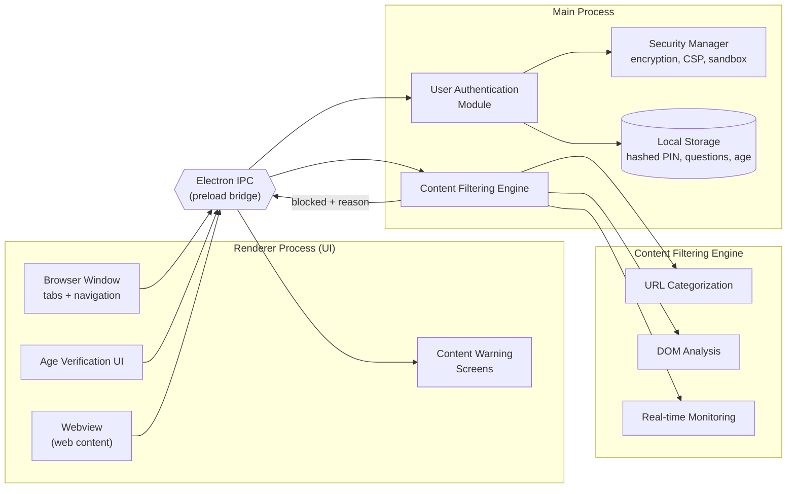
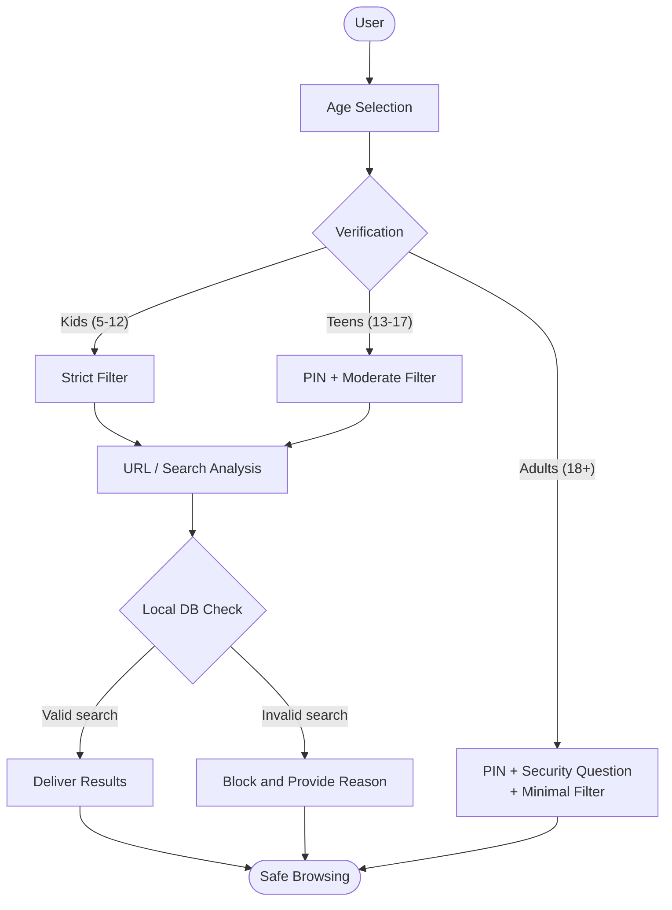
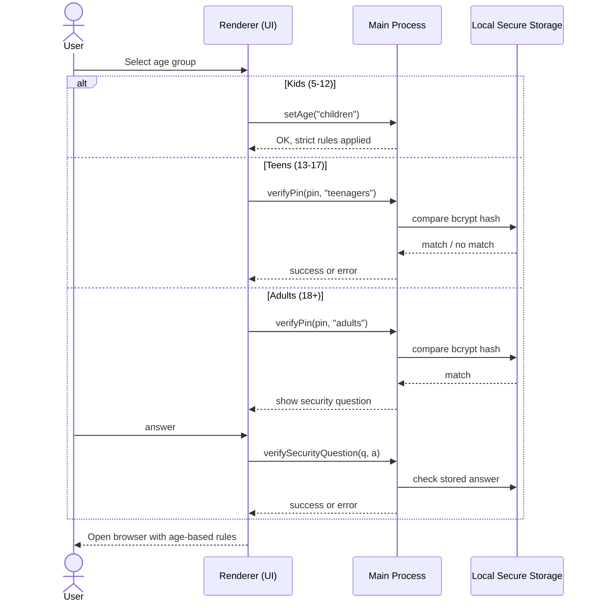
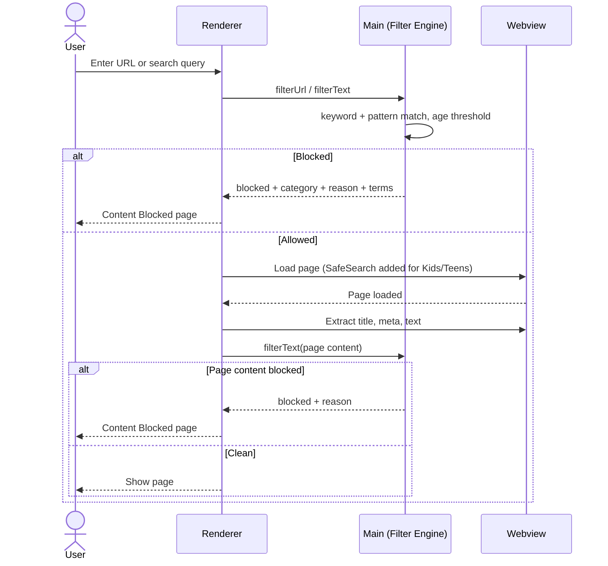

# AgeLock Browser

A privacy-first, age-adaptive desktop browser built on **Electron**. AgeLock applies content rules matched to the user's age group (Kids 5-12, Teens 13-17, Adults 18+) and runs all filtering **locally on the device**, with no browsing history collection and no external telemetry.

> B.E. Project, Dept. of Computer Science and Engineering
> Gokaraju Lailavathi Womens Engineering College, Hyderabad

---

## Why AgeLock?

Most parental-control tools rely on static blacklists or keyword lists, apply the same rules to everyone, send browsing data to external servers, and are easy for tech-savvy kids to bypass. AgeLock addresses this with:

- Age-based filtering levels instead of one-size-fits-all rules
- On-device processing (privacy-by-design)
- PIN and security-question gates for higher age tiers
- Explainable blocking: the block page shows the category, reason and matching terms

## Features

| Area | Details |
|---|---|
| **Age profiles** | Kids (5-12) strict, Teens (13-17) moderate, Adults (18+) minimal filtering |
| **Verification** | PIN for Teens; PIN + security question for Adults; PINs hashed locally with bcrypt.js |
| **Content filtering** | Regex keyword filtering, URL analysis/categorization, DOM analysis, real-time monitoring |
| **Search** | Integrated search with SafeSearch enforcement per age group |
| **Whitelisting** | Educational searches and sites are recognized and allowed |
| **Video player** | Built-in player with custom controls and keyboard shortcuts |
| **Blocked page** | Shows category, reason, matching terms and a Go Back button |
| **Privacy** | No history, no telemetry, no cloud calls for filtering |

### Filtering categories

The rule engine monitors seven categories: **sexual content, violence, hate speech, harassment, self-harm, drugs and gambling**. Sensitivity thresholds differ by age group:

| Age group | Level | Threshold |
|---|---|---|
| Kids (5-12) | Most restrictive | starts at 0.1 |
| Teens (13-17) | Moderate | 0.3 - 0.6 |
| Adults (18+) | Most permissive | 0.7 - 0.9 |

---

## Architecture

AgeLock follows a modular Electron design. Sensitive operations (age verification, filtering) run in the **main process**. The renderer talks to it only through **IPC**, so it never touches system resources directly.



### Methodology (request flow)



### Age verification sequence



### Content filtering sequence



---

## Tech Stack

| Layer | Technology |
|---|---|
| Framework | Electron 20+ |
| Runtime | Node.js 16+ |
| UI | HTML5, CSS3, JavaScript (ES6+) |
| Browser core | Minimal-Browser.js |
| Security | Web Crypto API, bcrypt.js (local PIN hashing) |
| Testing | Jest, Spectron, Cypress |
| Packaging | Electron Builder (Windows, macOS, Linux) |
| Tools | VS Code, npm/Yarn, Git |

## System Requirements

- **OS:** Windows 10/11, macOS 10.14+, or Ubuntu 18.04+
- **CPU:** dual-core 1.8 GHz or faster
- **RAM:** 4 GB
- **Storage:** 500 MB free
- **Display:** 1024x768 or higher

---

## Getting Started

```bash
# 1. Clone
git clone https://github.com/<your-username>/<your-repo>.git
cd <your-repo>

# 2. Install dependencies
npm install

# 3. Run in development
npm start

# 4. Package for your OS
npm run build
```

> Adjust the script names above to match your `package.json`.

### Default PIN

The app starts with a default PIN (`1234`) and prompts you to set a custom one. **Change it before real use.**

## Usage

1. Launch AgeLock and choose an age group.
2. Teens and Adults must enter the parental-control PIN. Adults also answer a security question.
3. Type a URL or search query in the address bar.
4. Blocked content shows the category, reason and matching terms.

## Project Structure

```
.
├── minimal-browser.js      # Main process: windows, IPC, age + PIN handling
├── security-filter.js      # Content filtering rules and thresholds
├── preload.js              # Safe IPC bridge (window.api)
├── index.html              # Age selection, modals, browser UI
├── package.json
├── tests/                  # Jest / Cypress tests
└── docs/
    └── images/             # Screenshots for this README
```

---

## Results

### Performance comparison (from project testing)

| Metric | AgeLock | Firefox | Chrome | Edge | Safari | Yahoo |
|---|---|---|---|---|---|---|
| Page load (ms) | 980 | 850 | 820 | 830 | 800 | 900 |
| DOM load (ms) | 780 | 650 | 630 | 640 | 620 | 700 |
| First Contentful Paint (ms) | 1200 | 950 | 900 | 920 | 890 | 1000 |
| Time to Interactive (ms) | 1500 | 1200 | 1150 | 1180 | 1100 | 1300 |
| Memory usage | **450** | 600 | 650 | 620 | 580 | 700 |

AgeLock loads somewhat slower because every page passes through the filtering layer, but it uses the least memory of the browsers compared.

### Filtering accuracy

Keyword-based filtering reached roughly **70-75% accuracy** in blocking inappropriate content. See Limitations below.

### Screenshots

Add your figures to `docs/images/` and reference them here:

```markdown


```

---

## Testing

- **Unit tests:** individual modules (Jest)
- **Integration tests:** Content Filtering, Authentication and Parental Control interaction
- **End-to-end:** automated browser workflows (Cypress)
- **Security checks:** penetration testing and vulnerability scanning

## Limitations

- Filtering is **rule-based** (word lists and pattern matching), so it can miss context and produce false positives or negatives
- There is no dynamic learning or user-feedback loop yet
- Security is basic (PIN + session management); a determined user may be able to tamper with local settings
- Whitelisting covers a limited set of educational terms and sites

## Roadmap

- [ ] NLP text classification (e.g. DistilBERT with SHAP explanations) and image moderation (NSFW.js) via TensorFlow.js
- [ ] Hardware-bound, non-resettable age credentials (TPM 2.0 / Secure Enclave)
- [ ] Curated whitelist of pre-approved sites for ages 5-8
- [ ] Parental controls: time limits, activity monitoring, custom filters
- [ ] Biometric login and built-in VPN
- [ ] Web workers for sub-2s page loads
- [ ] Learning mode with verified educational content
- [ ] Mobile apps and browser extensions
- [ ] Age-appropriate themes and UI

## Privacy

AgeLock does not collect browsing history, does not use persistent identifiers, and sends no telemetry. Filtering decisions are made on the device.

## Team

<!-- Add team member names and roll numbers -->

**Guide:** <!-- add guide name -->

## License

Add a license (e.g. MIT) before publishing.
